# 1. 商品管理アプリケーション

個人経営のペットサロンの店主が、販売しているペット用品の在庫管理や発注をするために作成した商品管理アプリケーションです。


## 2. 開発した背景や理由

妹が実際にトリマーとしてペットサロンを個人経営し、ペット用品も合わせて販売しているので、それをヒントに商品の管理アプリを作ってみようと思いました。「小さいお店の店主が一人で商品管理をする」という想定だったので、ログインの管理についてもシンプルに店主一人だけが対象という形をとりました。


## 3. アプリ作成にあたっての工夫と苦労した点、つまずいたところをどう解決したかについて

- 工夫した点
⇒　Reactが持つSPAを活かして、商品登録や編集などスムーズに動くアプリケーションを作ることができました。また設計当初は自分の知識や技術的に間に合うか不安で実装する予定がなかった、商品一覧からの商品検索(商品名とカテゴリの2種)と、在庫数が3を下回ると上部のメッセージバナーで表示する機能、発注したい時にすぐサイトへ移動できるように注文ボタンも追加で実装することができて、より使いやすいアプリにすることができたと思います。
またログイン側の処理はNode.jsが、商品データ側はJava/SpringBoot側が行っていたのですが、ログイン側の処理もJava/SpringBoot側に変更して、ターミナルを3つ開かなくても起動できるように改善しました。
商品一覧画面のヘッダー部分の背景画像は、最初配置した際に左右に左右に余白が3cm程出来てしまったため、ヘッダーに適した画像サイズになるようにPhotoshop Elementsを使ってサイズを修正した後、アップしなおしました。


- 苦労した点
⇒　Webアプリケーション開発3の「開発環境構築」の実装イメージの所で、「データベース環境を準備する(H2を利用できる状態にする)」とあり、AIに補佐してもらいながら実装したのですが、H2がどんなものか授業で触れた記憶がなく、またH2でもデータ保存ができるとAIに教えてもらったので、SQLiteがなくても簡単なアプリならH2で問題ないのかと思い込んで作業を進めてしまいました。
ところが後になってH2がどんなものか分かり、フロントエンド側も出来上がってそれなりに動作も出来ていたのですが、再びバックエンド側の設定を直すことになり時間を費やしてしまいました。
なんとなく形になってから必要に応じて修正すればいいのではと思っていましたが、自分の理解が不足していたがためにサポートのAIを使っても遠回りをすることが多かったように思います。


- つまずいたところをどう解決したか
⇒　本を読んでも欲しい答えが見つけられないことが多かったので、AIに方法を尋ねて丁寧に確認しながら進めていきました。ただ、AIも間違った内容を返すこともあるため、自分でおかしいと思った時はこちらから聞き返して確認し、分からない所はまた随時尋ね、覚えられるようにメモをとって進めていきました。そうすることで前よりも理解した上で、AIに必要な質問をすることができるようになったと感じています。
苦労した点に書いた通り、バックグラウンド側の変更・修正に時間がかかった他にもつまずいた点はいくつかあるのですが、以下3点をあげます。

- アプリの動作確認をしていた時、「商品管理一覧」に商品を追加し、その後削除してまた違う商品を新規で追加した時に左側のIDが連番にならないことに気付きました。SQLite側で割り振られたIDをそのまま画面に表示していたので、画面の表示方法を連番になるようにして不自然さを修正しました。
- ログイン情報が読み込まれる前にReact側で商品データが取得できる仕様になっていたので、セキュリティのために取得制御を修正しました。ただ、SpringBoot側の認証チェックの設定までは時間が足りず修正できなかったので詰めが甘い点が残りました。
- 商品一覧に情報を何件か入れていた時にエラーが発生して、SpringBootの接続を確認してくださいというメッセージが出たのですが、何度確認しても原因が分からずAIに質問したところ、商品画像のデータ量が多くてエラーになっていることが分かりました。そのためSpringBoot側の設定にその点も加えて改善、解決することができました。


## 4. アプリケーションの画像

### ログイン画面

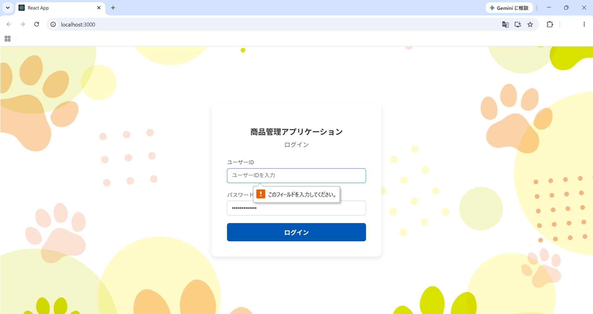
ログインIDとパスワードでの認証機能を実装しました。未入力場合は画像のように「このフィールドを入力してください」というエラーメッセージが出るようにしています。

### 商品一覧画面
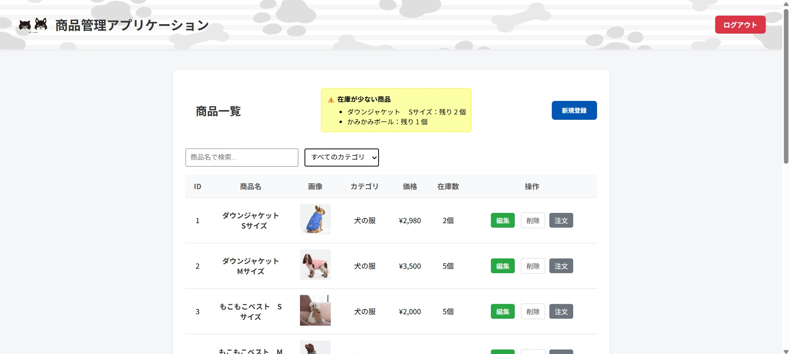
商品の一覧画面画面には、商品ID、商品名、画像、カテゴリ、価格、在庫数を表示し、右側に「編集」「削除」「注文」ボタンをそれぞれ横並びで配置しています。一覧の右上に「新規登録」、上部には在庫数が3を下回るとその商品名の在庫不足を知らせるメッセージ表示機能も配置しました。「ログアウト」ボタンはヘッダーの右側に赤系の色で分かりやすいように配置しています。
※最初の設計書から新たに追加した機能は「商品の画像表示」「商品の検索」「在庫不足を知らせるメッセージ」「注文」(外部リンク)です。


### 商品情報の編集画面
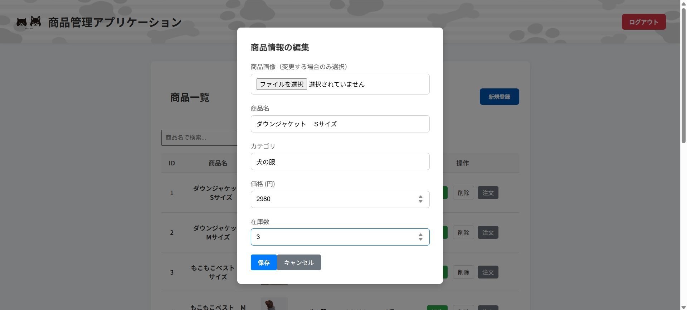
商品の値段と在庫数の数値入力フィールドには直接入力だけでなくスピンボタンも配置し、軽微な数字調整もしやすいよう工夫しました。また商品画像は変更が必要な場合のみファイルを選択、選択しなければ元の画像のまま表示されるようにしています。


### 新規商品登録画面
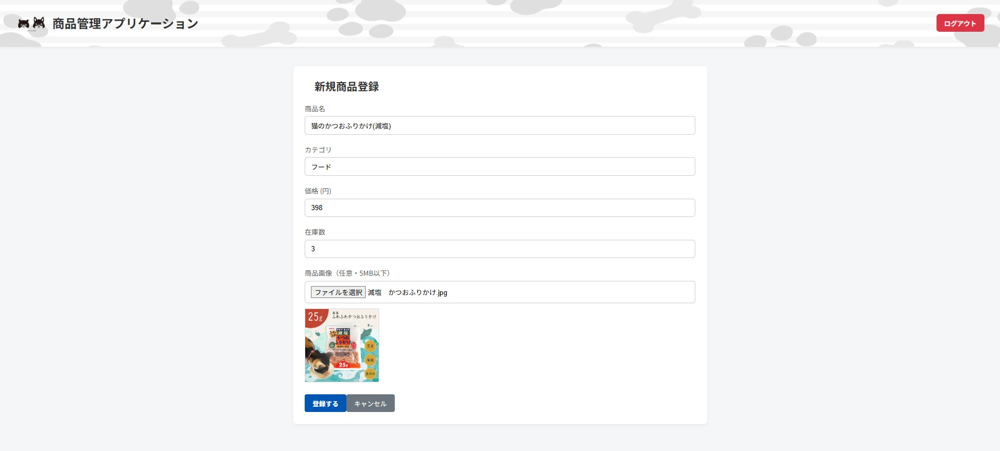
こちらも商品の値段と在庫数の数値入力フィールドにはスピンボタンを配置しています。また画像は任意にしており、その時画像が用意できなかった場合でも商品登録だけは可能にし、編集画面から後で画像追加できるようしています。


### 商品一覧からの削除画面
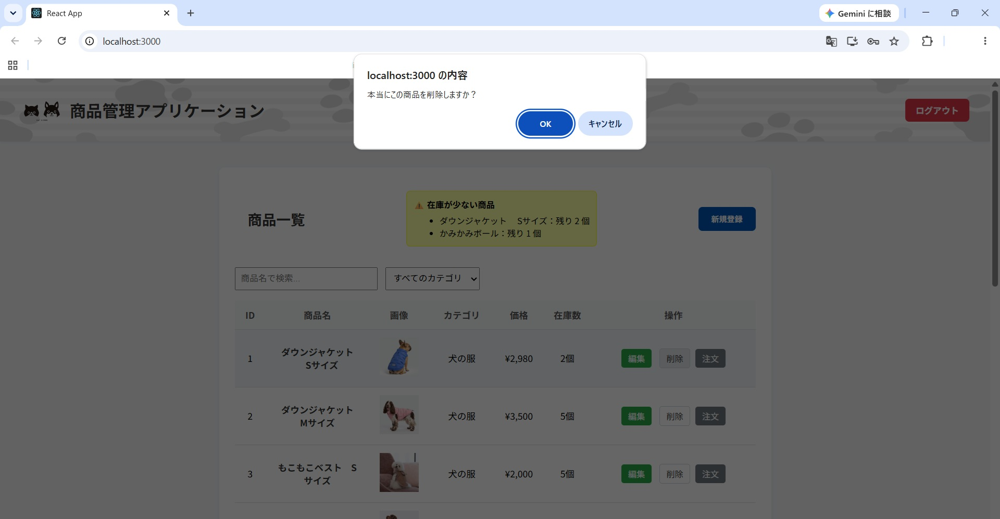
削除ボタンを押すと上部に「本当にこの商品を削除しますか」というメッセージが入り、誤って即座に削除することがないようにしています。


### 注文ボタンからの画面遷移
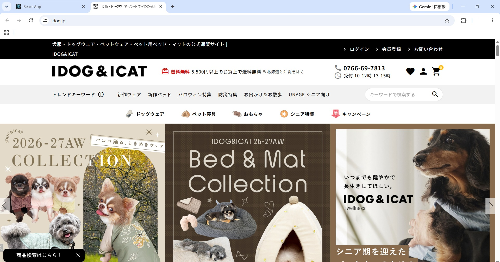
ボタンをクリックすると、別のタブで外部サイトが開くようにしています。
(※リンク先は妹が実際、販売品を購入しているペット商品大手サイトさんです)


### カテゴリーからの商品検索画面
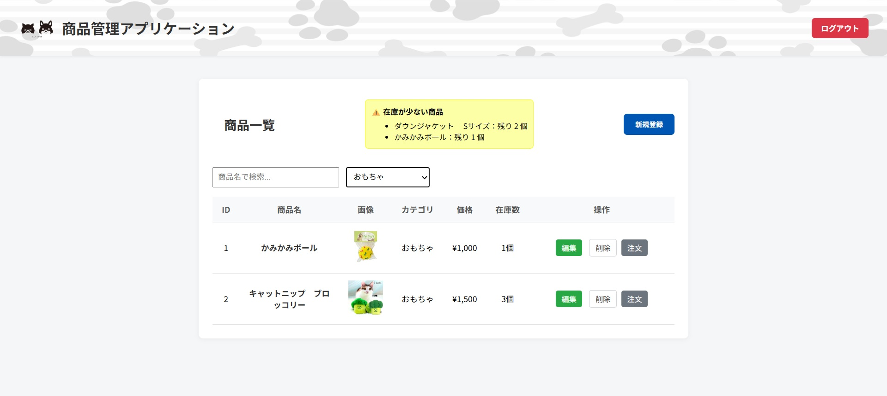
既に登録してあるカテゴリーの一覧が表示され、選ぶとそのカテゴリーの商品のみ一覧に出るようにしています。


### 商品名からの商品検索画面
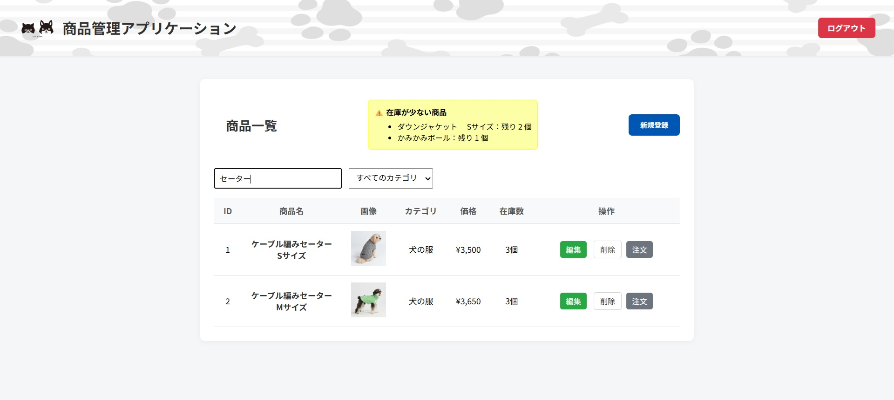
商品名の一部ワード(※上記画像は「セーター」というワード)を入力すると、その商品の一覧が表示されるようにしています。


## 5. 使用技術（技術スタック）

| 分類 | 使用技術 |
|---|---|
| フロントエンド | HTML / CSS / JavaScript / React |
| バックエンド | Java / Spring Boot |
| データベース | SQLite |
| 開発ツール | Visual Studio Code / Git / GitHub |


## 6. ER図
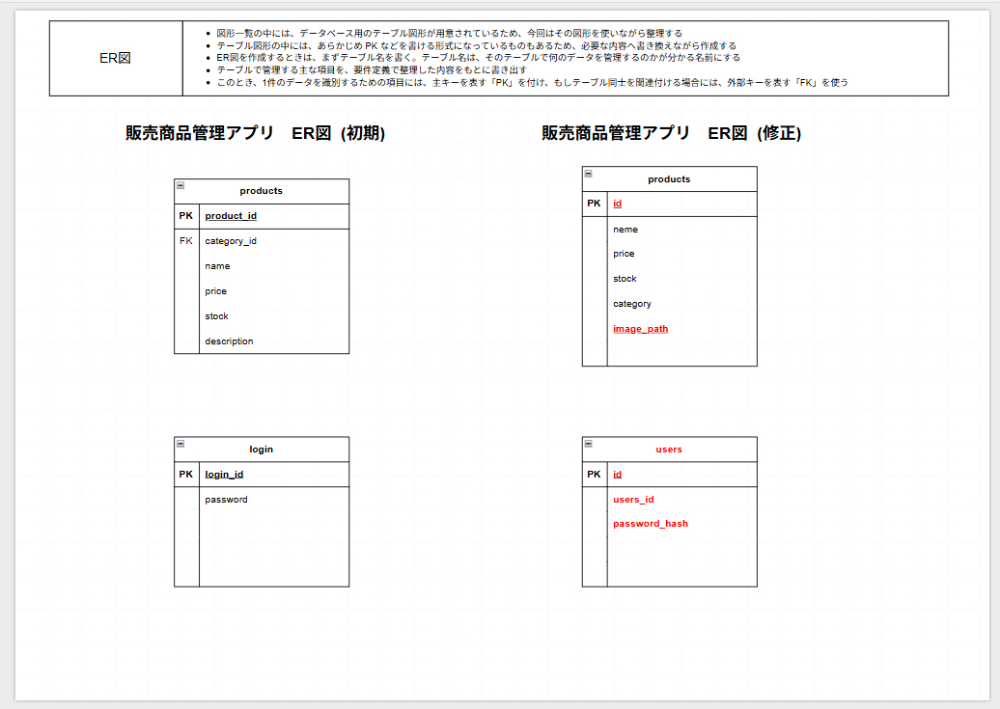
「login」テーブル名を「users」に変更。「user_id」(重複不可のログインid)「password_hash」(ハッシュ化したパスワード)に変更。
「products」テーブルには商品画像の保存先として「image_path」を項目に追加しました。

## その他　仕様変更について
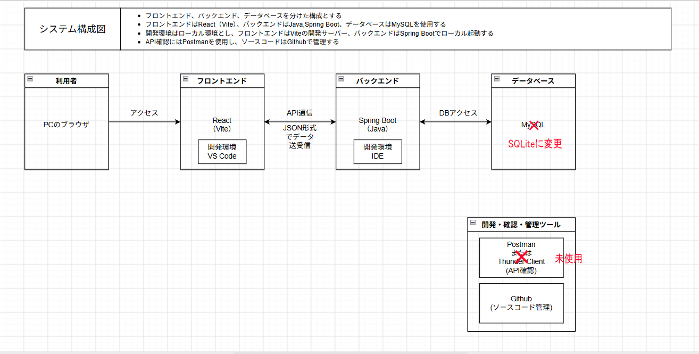
DBをMYSQLからSQLiteに変更しています。

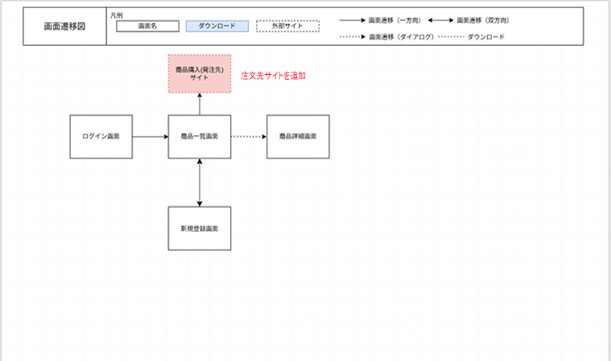
注文機能を追加したことで、外部サイトの画面遷移も追加しました。
また商品編集画面は別画面への遷移ではなくダイアログに変更しています。


## 7. ローカル環境での起動方法

### 1. 必要な環境

- Java 21
- Node.js / npm
- Git（GitHubからソースコードを取得する場合）

### 2. バックエンドの起動（Spring Boot）

1. ターミナルを開き、プロジェクト内の `product` フォルダに移動します。

   ```bash
   cd product
   ```

2. Spring Bootを起動します。

   Windowsの場合：

   ```powershell
   .\mvnw.cmd spring-boot:run
   ```

3. 起動が完了するまで待ちます。バックエンドは `http://localhost:8080` で動作します。

### 3. フロントエンドの起動（React）

1. 別のターミナルを開き、プロジェクト内の `frontend` フォルダに移動します。

   ```bash
   cd frontend
   ```

2. 必要なパッケージをインストールします。

   ```bash
   npm install
   ```

3. Reactを起動します。

   ```bash
   npm start
   ```

4. ブラウザで `http://localhost:3000` にアクセスします。

### 4. アプリの利用

ログイン画面からログインし、商品管理機能を利用できます。
ユーザーID　→　shop-01
psaaword　→　564341wannyan

※ バックエンドとフロントエンドは、それぞれ別のターミナルで起動してください。

